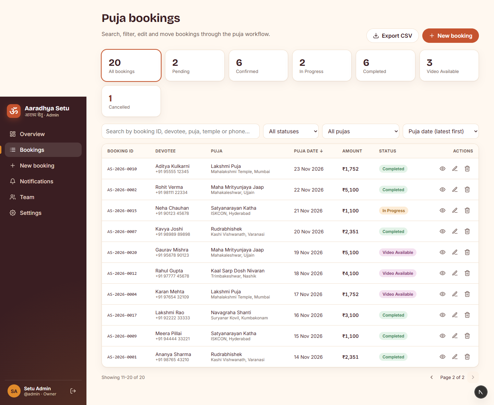
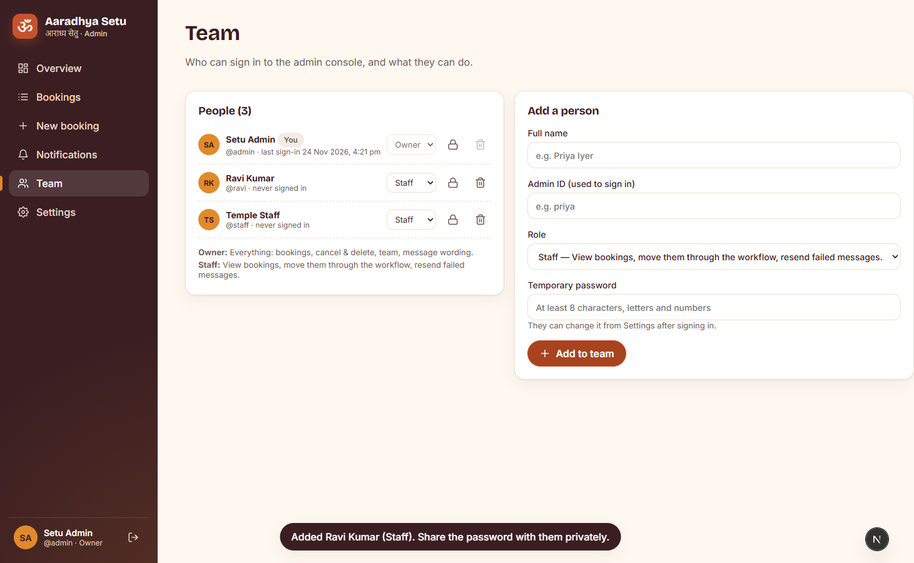
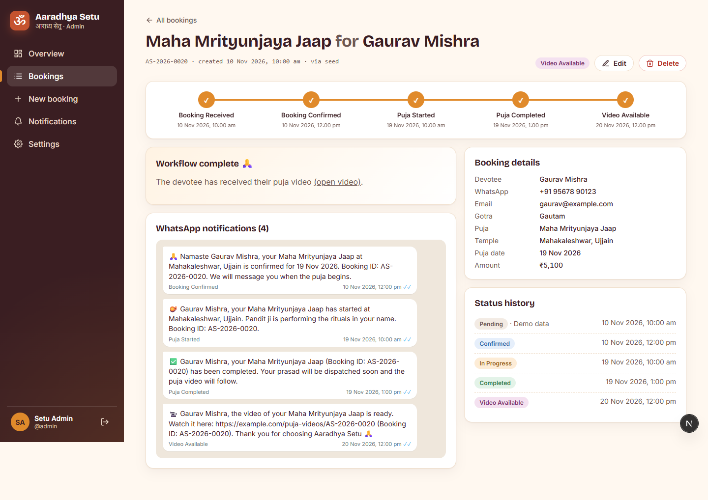

# Aaradhya Setu · Software Engineering Intern Assignment

**Mili Parashar** · IIT Madras (BS Data Science) · parasharmili19@gmail.com

My main submission is **Option 2, the puja booking admin dashboard** (Next.js + Node API routes + MongoDB). It runs with sign-in, roles, full booking CRUD, cancellation, server-side pagination and an editable message workflow. I also connected it to **Option 3** (workflow + WhatsApp notifications) and **Option 1** (Shopify puja product page), because the three are parts of one journey:

```
 Devotee                    Aaradhya Setu team                           Devotee's WhatsApp
 ───────                    ──────────────────                           ──────────────────
 Option 1                   Option 2                                     Option 3
 Shopify puja page  ──────► Admin dashboard (Next.js + MongoDB)  ──────► Workflow + notifications
 package, devotee   order   sign-in · roles · search · filter · CRUD     Confirmed → Puja Started →
 details, add-ons  webhook  cancel · paging · CSV · team · settings      Completed → Video Available
                                                                         (or Cancelled), with retries
```


---

## Run it locally

You need **Node.js 20.6+** and **MongoDB** (local Docker, or a free MongoDB Atlas cluster).

```bash
# 1. MongoDB (skip if you use Atlas)
docker compose up -d

# 2. The app
cd web
npm install
cp .env.example .env.local      # set MONGODB_URI if you use Atlas, and a long random AUTH_SECRET
npm run seed                    # demo bookings, WhatsApp history and two logins
npm run dev                     # http://localhost:3000

# Tests (no database needed)
npm test
```

**Demo logins** (created by `npm run seed`):

| Admin ID | Password | Role | Can |
|---|---|---|---|
| `admin` | `Setu@2026` | Owner | Everything |
| `staff` | `Staff@2026` | Staff | View bookings, move them through the workflow, resend failed messages |

The demo data has bookings at every stage, **one cancelled booking**, and **one devotee with a mistyped WhatsApp number**. Their message failed, so you can try the fix: **Edit** the number, then press **Resend**.

---

## Option 2 · Puja booking dashboard

### Sign-in


- **Designed after the aaradhyasetu.com sign-in screen** (maroon brand panel and cream form). Admins use an **admin ID and password** instead of the devotee WhatsApp OTP.
- **Passwords** are stored only as salted **scrypt** hashes, using Node's built-in `crypto` (no extra dependency).
- **Signed session cookie** (HMAC-SHA256, `httpOnly`, `sameSite=lax`, 8 hours). `middleware.js` checks it on **every page and API route**. Signed-out visitors go to `/login?next=…` and come back to the page they wanted.
- **Hardening:**
  - 5 failed attempts per ID + IP lock that ID for 15 minutes.
  - A wrong ID takes as long to check as a wrong password, so admin IDs can't be guessed from timing.
  - Changes sent from another website are refused (`403`).
  - `next=` only accepts paths inside the app.

### Bookings: search, filter, sort, paging, CRUD



- **Searchable table:** booking ID, devotee, puja (with temple), date, amount and status. Search covers ID, devotee, puja, temple and phone, and waits 250 ms after typing stops before querying.
- **Filters and sorting:** by status (dropdown or the clickable count cards, Cancelled included) and by puja. Sort by date, amount or devotee.
- **Server-side pagination:** MongoDB returns one page (`skip`/`limit`) plus a total count. The booking ID breaks ties in the sort, so paging never repeats or skips a row. The overview figures come from count and aggregation queries, not from loading every booking.
- **CSV export** of *every* matching booking, built on the server. Values that look like spreadsheet formulas are escaped so they can't run in Excel.
- **Create / Read / Update / Delete:**
  - **Create:** a form for phone or walk-in bookings. Shopify orders arrive automatically.
  - **Read:** a details page with devotee and puja info, add-ons, Shopify order, workflow stepper, status history and messages.
  - **Update:** only the fields that changed are sent. Status is deliberately **not** editable here; it only moves through the workflow, so the devotee is always notified.
  - **Delete:** owners only, after a confirmation dialog. It also removes the booking's message history, and the dialog suggests cancelling instead.
- **Overview:** key figures, bookings by stage, booking value by puja (click a bar to open the filtered list), this week's pujas, the latest messages and an alert when messages failed.

### Cancel instead of delete


Temples cancel far more often than they delete, so **Cancelled** is a final status that keeps the booking and its history:

- Possible while the booking is Pending, Confirmed or In Progress, but not after the puja is completed.
- A **reason is required**. Sending the devotee a WhatsApp message is optional, and the dialog previews it.
- Cancelled bookings are counted but **excluded from booking value**. They are shown crossed out in the table, with a banner on the booking page.

### Confirmation before anything irreversible


Moving a booking forward, cancelling it, deleting it and removing a team member all ask first. The status dialog shows the change (e.g. Pending → Confirmed), **the exact message the devotee will get**, and that it can't be rolled back.

### Roles: owner and staff



| Permission | Owner | Staff |
|---|:-:|:-:|
| View bookings, messages, overview | ✓ | ✓ |
| Move bookings through the workflow | ✓ | ✓ |
| Resend failed messages | ✓ | ✓ |
| Create, edit, cancel, delete bookings | ✓ | |
| Manage the team | ✓ | |
| Edit message wording | ✓ | |

- The rules live in one table (`lib/permissions.js`). The **API enforces them** (`403`), and the interface hides the buttons a role can't use.
- The server reads the admin's **current role from the database on every request**, so promoting, demoting or removing someone takes effect immediately, not when their session runs out.
- **Team page (owners):** add people with a temporary password, change roles, set a new password, remove people. You can't change your own role or remove yourself, and **there is always at least one owner**.

### Settings


- **Everyone:** see your account and **change your password**, which needs the current one.
- **Owners: edit the WhatsApp message wording without a code change**, with placeholder buttons and a live preview. The text is checked before saving:
  - unknown placeholders (e.g. `{{name}}`) and unclosed `{{` are refused;
  - `{{devoteeName}}`, `{{pujaName}}` and `{{bookingId}}` are required, plus `{{videoUrl}}` for the video message.
  - **Reset to default** is one click away, and the page shows who last edited each message.

## Option 3 · Booking workflow & notifications


- **One status list covers both options:** `Pending → Confirmed → In Progress → Completed → Video Available`, shown to staff as "Booking Received → Booking Confirmed → Puja Started → Puja Completed → Video Available". `Cancelled` is a side exit.
- **Automatic notifications:** every step renders its template (devotee name, puja, temple, date, booking ID, video link or cancel reason), "sends" it through the mock WhatsApp provider and saves it with its delivery result.
- **Failed messages and Resend:** like a real provider, the mock rejects malformed numbers (e.g. `+91` with 9 digits). `MOCK_WHATSAPP_FAILURE_RATE` can also make a share of sends fail at random. Failed messages are flagged on the booking, the Notifications page ("Failed only") and the overview. **Resend** sends to the booking's *current* number and counts attempts. Two people pressing Resend at once send it only once.
- **Notification history:** per booking (chat-style) and for all bookings on the Notifications page.



## Option 1 · Shopify custom puja product page

`shopify-theme/sections/aaradhya-puja-product.liquid` (+ CSS, JS, product template)


- **Visually aligned with aaradhyasetu.com:** colours taken from the live site (maroon `#3A1E22`, terracotta `#C5532F`, saffron `#E08A2B`, cream), Bricolage Grotesque headings, pill buttons.
- Main image and thumbnail gallery, description, price with compare-at price, and benefits from section blocks (or a `custom.benefits` metafield).
- **Package picker** (variants as pills), with live price, availability and variant id.
- **Devotee details for the sankalp** (name, WhatsApp number, gotra, puja date) sent as **line item properties**, so the booking system receives them with the order.
- **Optional offering add-ons**, a quantity selector and a live total. With JavaScript, the puja and its add-ons go to the cart in **one** `/cart/add.js` request; without JavaScript it still works as a normal Shopify form.
- **Mobile:** single column, large touch targets, and a sticky Add to Cart bar.

**Preview without a store:** `npx serve shopify-theme -l 5000`, then open http://localhost:5000/preview/.
**In a real store:** copy the section, assets and `templates/product.puja.json` into an Online Store 2.0 theme, create a puja product (vendor = temple, variants = packages) and assign the `product.puja` template. Optionally point an `orders/create` webhook to `/api/webhooks/shopify/orders-create`, with its secret in `SHOPIFY_WEBHOOK_SECRET`.

---

## Design decisions

- **Business rules live in one place, independent of the database.** The services (`bookings-service.js`, `auth-service.js`) take a `repo` argument: the app passes the MongoDB repo, the tests pass an in-memory one. So every rule is unit-tested without a database: workflow, cancel, roles, resend, paging, templates, team.
- **Bookings only move one step forward.** Skipping a step would skip a devotee message, and going backwards would send confusing ones. Cancellation is a separate action that needs a reason.
- **No double messages when two admins click at once.** Status changes and resends are conditional updates (`findOneAndUpdate({ bookingId, status: from })`), so the second request gets `409 Conflict` and nothing is sent twice.
- **A message is never sent with an empty placeholder.** Rendering throws if a value is missing, and edited templates are validated before saving.
- **Least privilege by default.** New team members are staff unless an owner chooses otherwise, and permissions are checked on the server against the live role.
- **Sequential, readable booking IDs** (`AS-2026-0001`) come from an atomic counter, so two bookings created at once never share an ID.
- **Mock WhatsApp is swappable.** `lib/notifier.js` returns `{ status: 'sent' | 'failed', error }`. Replacing its body with the WhatsApp Business Cloud API (or Twilio/Gupshup) is the only change needed to go live.

## API

All routes need a signed-in admin except the two marked *public*. Roles show where an action is limited.

| Method | Route | Purpose | Role |
|---|---|---|---|
| POST | `/api/auth/login` | `{ username, password }`, sets the session cookie | *public* |
| POST | `/api/auth/logout` | Clears the session | |
| GET | `/api/auth/me` | The signed-in admin | |
| POST | `/api/auth/password` | `{ currentPassword, newPassword }` | |
| GET | `/api/bookings?q=&status=&puja=&from=&to=&sort=&order=&page=&pageSize=` | One page + `total`, `pages` | |
| GET | `/api/bookings/export?…same filters` | CSV of all matches | |
| POST | `/api/bookings` | Create | owner |
| GET | `/api/bookings/:id` | Booking + its messages | |
| PUT | `/api/bookings/:id` | Edit details (not status) | owner |
| DELETE | `/api/bookings/:id` | Delete booking + messages | owner |
| PATCH | `/api/bookings/:id/status` | `{ status, videoUrl?, note? }`, one step forward + message | owner, staff |
| POST | `/api/bookings/:id/cancel` | `{ reason, notifyDevotee }` | owner |
| GET | `/api/notifications?bookingId=&status=&delivery=failed` | Message history | |
| POST | `/api/notifications/:id/resend` | Retry a failed message | owner, staff |
| GET | `/api/stats` | Counts, booking value, by puja, upcoming, failed messages | |
| GET | `/api/templates` | Current wording, defaults and placeholder rules | |
| PUT / DELETE | `/api/templates/:status` | Save / reset a message | owner |
| GET / POST | `/api/admins` | List / add team members | owner |
| PATCH / DELETE | `/api/admins/:username` | Change name, role or password / remove | owner |
| POST | `/api/webhooks/shopify/orders-create` | Shopify order → booking(s), HMAC-verified | *public* |

Errors come back as `{ "error": "..." }` with the right status code: 400 validation, 401 signed out, 403 not allowed or cross-site, 404 not found, 409 conflict or invalid transition, 429 too many sign-in attempts.

## Project structure

```
web/
  middleware.js             Sign-in check on every page + API route
  app/
    login/                  Sign-in page
    (admin)/layout.js       Sidebar shell; loads the signed-in admin and their role
    (admin)/page.js         Overview
    (admin)/bookings/       Table, new, [id] details + workflow + cancel, [id]/edit
    (admin)/notifications/  All messages, failed filter, resend
    (admin)/team/           Team management (owners)
    (admin)/settings/       Password + message templates
    api/...                 Route handlers (thin: check role → call service)
  components/               Admin shell + role context, booking form, message bubble, dialogs, icons
  lib/
    workflow.js             Statuses, transitions, default templates and placeholder rules
    bookings-service.js     Booking rules: CRUD, paging, workflow, cancel, resend, templates, stats
    auth-service.js         Login, team management, passwords
    permissions.js          Owner / staff permission table
    current-admin.js        Loads the signed-in admin and checks a permission
    session.js              Signed session cookie (Web Crypto, works in middleware)
    passwords.js            scrypt hashing
    notifier.js             Mock WhatsApp sender (can fail)
    repo/mongo-repo.js      MongoDB data layer
    repo/memory-repo.js     In-memory data layer for tests
    models/index.js         Booking, Notification, Counter, Admin, Template
    seed-data.js, seed.js   Demo data, generated through the real workflow
  scripts/                  seed.mjs, create-admin.mjs
  tests/                    bookings, auth and features tests (node --test)
shopify-theme/              Option 1: section, assets, template, static preview
```

## Testing

- **`npm test`:** 27 unit tests, no database needed:
  - workflow rules, templates and validation;
  - search, filters and sorting; server-side paging (stable order, caps, last page); CSV escaping;
  - the full status journey with notifications, and concurrent clicks;
  - cancel (reason, optional message, excluded from booking value);
  - failed messages and resend (including two people resending at once);
  - roles, team management guards, password change, session signing/expiry/tampering;
  - editable templates; the Shopify order mapping.
- **End to end in a real browser (Playwright + Edge):**
  - sign in, wrong password, redirect back after sign-in;
  - owner and staff permissions (staff get `403` from the API, and a removed member is signed out on their next request);
  - edit, cancel, delete and status confirmation;
  - the failed-message → edit number → resend flow;
  - paging across pages, CSV export, template validation and use, password change;
  - no horizontal scrolling at phone width.

## What I'd do next

- Real WhatsApp Business API with approved templates, and automatic retries with back-off.
- Shared rate limiting (Redis) when running on several servers, and an audit log page.
- Upload the puja video directly (S3) instead of pasting a link.
- Refunds linked to cancellations.

*AI tools were used while building this, as the brief allows. I can walk through and explain every part of the code.*
