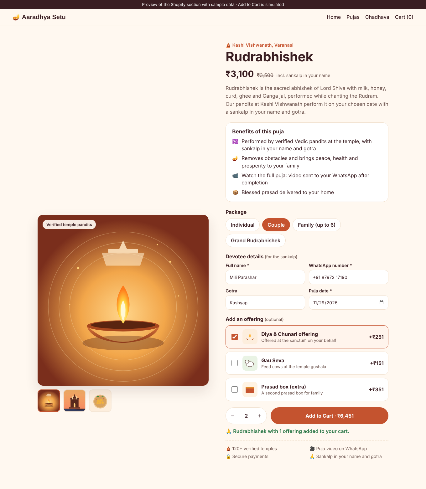
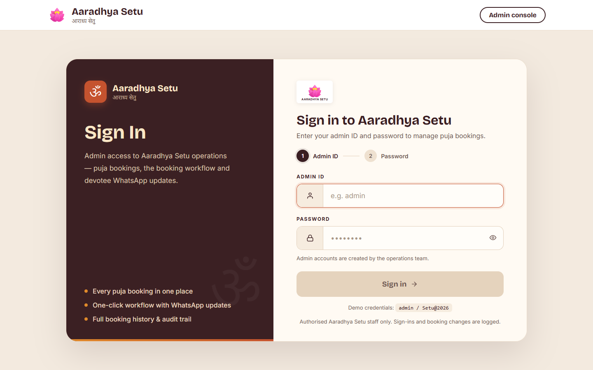
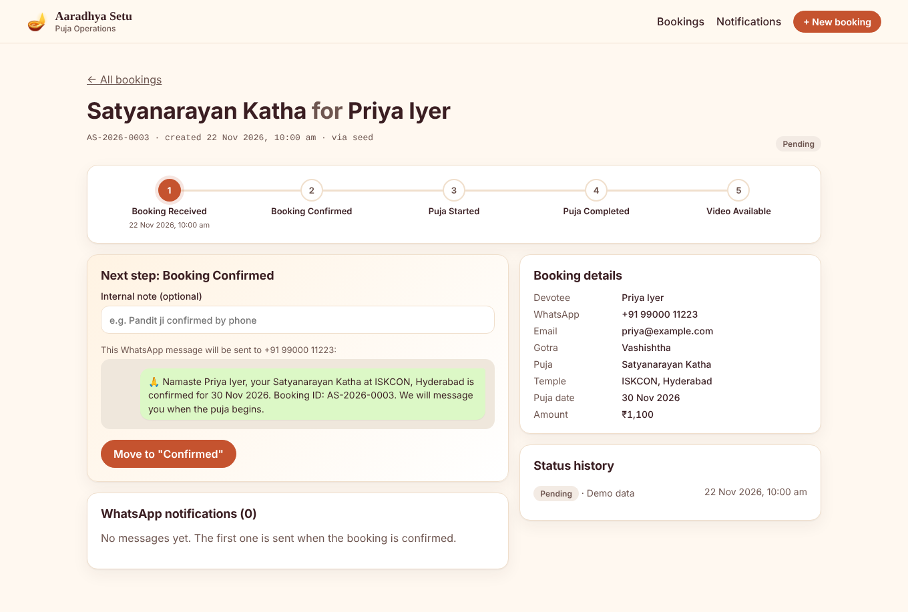
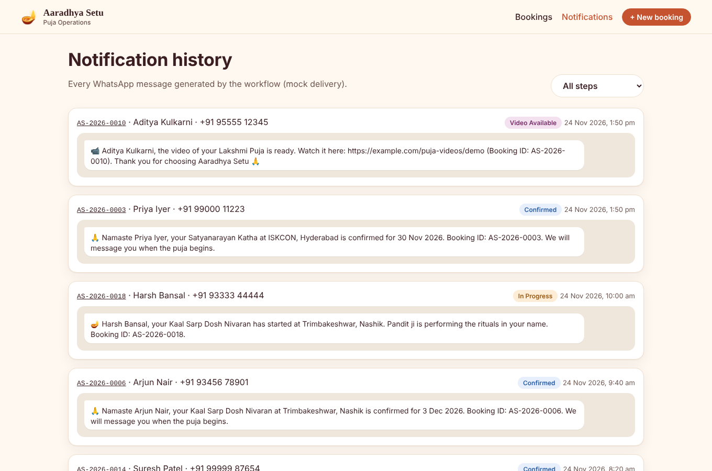

# Aaradhya Setu · Software Engineering Intern Assignment

**Mili Parashar** · IIT Madras (BS Data Science) · parasharmili19@gmail.com

The brief asked for any one of three tasks. I built **all three as one connected system**, because they are three parts of the same journey:

```
 Devotee                    Aaradhya Setu team                         Devotee's WhatsApp
 ───────                    ──────────────────                         ──────────────────
 Option 1                   Option 2                                   Option 3
 Shopify puja page  ──────► Booking dashboard (Next.js + MongoDB) ───► Workflow + notifications
 picks package,     order   search · filter · sort · details           Confirmed → Puja Started →
 devotee details,  webhook  status changes                             Puja Completed → Video Available
 add-ons, cart                                                         templated message on every step
```

1. A devotee books a puja on the **Shopify product page** (Option 1). Their name, WhatsApp number, gotra and puja date travel with the order as line item properties.
2. Shopify's `orders/create` webhook calls the app, which turns the order into a **Pending booking** in the **admin dashboard** (Option 2).
3. The team moves the booking through the **workflow** (Option 3). Every step automatically generates a **WhatsApp message from a template** (mocked), and the app saves it to the notification history.

| Option | Where | Status |
|---|---|---|
| 1 · Shopify custom puja product page | `shopify-theme/` | Liquid section + CSS/JS assets + product template, and a static preview |
| 2 · Puja booking dashboard | `web/` | Next.js 15 + React 19 + Node API routes + MongoDB (Mongoose) |
| 3 · Booking workflow & notifications | `web/` | Same app: one-step workflow, templates, mock WhatsApp, saved history |


---

## Run it locally

You need Node.js 20.6+ and MongoDB (local Docker, or a free MongoDB Atlas cluster).

```bash
# 1. MongoDB (skip if you use Atlas)
docker compose up -d

# 2. The app
cd web
npm install
cp .env.example .env.local      # set MONGODB_URI if you use Atlas
npm run seed                    # 20 demo bookings + WhatsApp history + the admin login
npm run dev                     # http://localhost:3000  → sign in with  admin / Setu@2026

# Tests (no database needed)
npm test
```

**Shopify preview without a store:** serve the theme folder and open the preview page:

```bash
npx serve shopify-theme     # then open http://localhost:3000/preview/
```

**Installing in a real Shopify store (dev store):**

1. Copy `sections/aaradhya-puja-product.liquid`, `assets/aaradhya-puja-product.css`, `assets/aaradhya-puja-product.js` and `templates/product.puja.json` into the theme (Dawn or any Online Store 2.0 theme), e.g. with `shopify theme push`.
2. Create a puja product. The vendor is the temple name, variants are packages (Individual / Couple / Family). Assign it the `product.puja` template.
3. In the theme editor, pick the add-on products (diya, gau seva, prasad box) in the "Offering add-on" blocks.
4. Optional: add an `orders/create` webhook pointing to `https://<app-url>/api/webhooks/shopify/orders-create` and put its signing secret in `SHOPIFY_WEBHOOK_SECRET`.

---

## Option 1 · Shopify custom puja product page

`shopify-theme/sections/aaradhya-puja-product.liquid` (+ CSS, JS, product template)



- **Visually aligned with aaradhyasetu.com:** I took the colours from the live site (maroon `#3A1E22`, terracotta `#C5532F`, saffron `#E08A2B`, cream background), plus the Bricolage Grotesque headings and pill-shaped buttons.
- **Imagery:** a main image with a thumbnail gallery (a variant's own image is shown when it is selected).
- **Description, price (with compare-at price) and benefits:** benefits come from section blocks, or fall back to a `custom.benefits` metafield.
- **Package picker:** Shopify variants shown as pills. Price, availability ("Sold out") and the hidden variant id update live.
- **Devotee details for the sankalp:** name, WhatsApp number, gotra and puja date (no past dates). These are sent as **line item properties**, so the booking system receives them with the order.
- **Optional offering add-ons** (diya & chunari, gau seva, prasad box): chosen in the theme editor as section blocks.
- **Quantity selector and live total:** total = package price × quantity + add-ons.
- **Add to Cart:** with JavaScript, the puja **and** the selected add-ons go to the cart in **one** `/cart/add.js` request. Without JavaScript, the form still works as a normal Shopify product form.
- **Mobile:** single-column layout, large touch targets, and a **sticky Add to Cart bar** while the main button is off screen.
- **Accessibility:** real form labels, `aria-live` status messages, invalid fields are marked and focused.
- Everything (colours, badge, headings, add-ons, trust points, "after add to cart" behaviour) is editable in the theme editor.

## Option 2 · Puja booking dashboard

### Admin sign-in



- **Sign-in page modelled on the aaradhyasetu.com sign-in screen** (maroon brand panel + cream form), using an **admin ID and password** instead of the devotee WhatsApp OTP.
- **Admin accounts live in MongoDB**, passwords stored only as salted **scrypt** hashes (Node's built-in `crypto`, no extra dependency). `npm run seed` creates `admin / Setu@2026` (change it with `ADMIN_USERNAME` / `ADMIN_PASSWORD`); add more with `npm run create-admin -- <id> <password> "<Full name>"`.
- **Signed session cookie** (HMAC-SHA256, `httpOnly`, `sameSite=lax`, 8-hour expiry) checked by `middleware.js` on **every page and API route**. Signed-out visitors are sent to `/login?next=…` and returned to the page they wanted; the API answers `401`.
- **Hardening:** 5 failed attempts per ID + IP lock that ID for 15 minutes; a wrong ID takes as long to check as a wrong password (no user enumeration); state-changing API calls from another origin are rejected (`403`); `next=` only accepts in-app paths.
- **Audit trail:** each booking records who created and last edited it, and every status change records which admin made it.

### Dashboard & CRUD


- **Overview:** key figures (bookings, booking value, awaiting confirmation, pujas in the next 7 days), bookings by stage and booking value by puja (click a bar to open the filtered list), this week's pujas and the latest WhatsApp updates.
- **Create / Read / Update / Delete:** *New booking* form; details page; **Edit** (only changed fields are sent; status is deliberately not editable, it moves through the workflow so the devotee is always notified); **Delete** with a confirmation dialog, which also removes that booking's notification history.
- Table rows have View / Edit / Delete actions, 10-per-page pagination and **CSV export** of the current filtered list.



- **Searchable table:** Booking ID, devotee, puja (with temple), date, amount and status. Search covers booking ID, devotee name, puja, temple and phone, with a debounce so it doesn't query on every keystroke.
- **Filters:** by status (dropdown or clickable summary cards) and by puja.
- **Sorting:** by date, amount or devotee (click a column header, or use the dropdown).
- **Booking details view:** devotee and puja info, add-ons, Shopify order id, workflow stepper and status history.
- **Status changes** with database persistence (MongoDB via Mongoose), plus a **New booking** form for phone or offline bookings.
- **Responsive:** works on a phone for staff at the temple.

## Option 3 · Booking workflow & notifications


- **One status list covers both options:** `Pending → Confirmed → In Progress → Completed → Video Available`. In the workflow view these appear as "Booking Received → Booking Confirmed → Puja Started → Puja Completed → Video Available".
- **Admin interface:** the details page shows the next step and a **live preview of the exact WhatsApp message** before it is sent.
- **Automatic notifications:** every status change renders a template with the devotee name, puja name, temple, date, booking ID and video link, "sends" it through a mock WhatsApp provider, and saves it with a delivery receipt.
- **Notification history:** per booking (chat-style bubbles) and for all bookings on the Notifications page.



---

## Design decisions (what I'd explain in the review)

- **Business rules live in one place, independent of the database.** `web/lib/bookings-service.js` takes a `repo` argument. The app passes the MongoDB repo; the tests pass an in-memory repo. That's why every rule (search, filters, sorting, validation, the workflow, notifications, the Shopify order mapping) is tested without a database.
- **Bookings only move one step forward.** Skipping a step would skip a devotee notification, and moving backwards would send confusing messages.
- **No double messages when two admins click at once.** The status update is conditional: `findOneAndUpdate({ bookingId, status: from })`. If someone else already moved the booking, the second request gets `409 Conflict`, and no duplicate WhatsApp message is sent. This is covered by a test.
- **A message is never sent with an empty placeholder.** `renderTemplate` throws if a value is missing (e.g. no video link). The "Video Available" step requires a valid http(s) link.
- **Sequential, readable booking IDs** (`AS-2026-0001`) come from an atomic counter document, so two bookings created at the same moment never get the same ID.
- **Shopify → bookings:** the webhook verifies Shopify's HMAC signature when a secret is configured. Each puja line item becomes one booking, and add-on lines are attached to it and included in the amount.
- **Mock WhatsApp is swappable.** `lib/notifier.js` returns a delivery receipt; replacing its body with a call to the WhatsApp Business Cloud API (or Twilio/Gupshup) is the only change needed to go live.

## API

| Method | Route | Purpose |
|---|---|---|
| GET | `/api/bookings?q=&status=&puja=&from=&to=&sort=date\|amount\|devotee\|created&order=asc\|desc` | Search / filter / sort |
| POST | `/api/bookings` | Create a booking |
| GET | `/api/bookings/:bookingId` | Booking + its notification history |
| PUT | `/api/bookings/:bookingId` | Edit details `{ devoteeName?, phone?, email?, gotra?, pujaName?, templeName?, pujaDate?, amount? }` |
| DELETE | `/api/bookings/:bookingId` | Delete the booking and its notifications |
| PATCH | `/api/bookings/:bookingId/status` | `{ status, videoUrl?, note? }` move one step forward, send + save notification |
| GET | `/api/notifications?bookingId=&status=` | Notification history |
| GET | `/api/stats` | Counts per status, revenue, puja list |
| POST | `/api/webhooks/shopify/orders-create` | Shopify order → booking(s) (public, HMAC-verified) |
| POST | `/api/auth/login` | `{ username, password }` → sets the session cookie (public) |
| POST | `/api/auth/logout` | Clears the session |
| GET | `/api/auth/me` | The signed-in admin |

All routes except the two marked *public* require a signed-in admin.

Errors come back as `{ "error": "..." }` with the right status code (400 validation, 401 signed out, 403 cross-site, 404 not found, 409 invalid transition/conflict, 429 too many login attempts).

## Project structure

```
web/
  middleware.js             Signs-in check on every page + API route
  app/                      Next.js App Router
    login/                  Admin sign-in page
    (admin)/layout.js       Sidebar shell (only for signed-in admins)
    (admin)/page.js         Overview: key figures, charts, upcoming pujas
    (admin)/bookings/       Table (Option 2), new, [id] details + workflow (Option 3), [id]/edit
    (admin)/notifications/  All notifications (Option 3)
    api/...                 Route handlers (thin: parse request → call service)
  components/               Admin shell, booking form, shared UI, icons
  lib/
    workflow.js             Statuses, allowed transitions, message templates
    bookings-service.js     All booking rules: CRUD, workflow, stats (database-independent)
    auth-service.js         Admin accounts and login check
    session.js              Signed session cookie (Web Crypto, works in middleware)
    passwords.js            scrypt password hashing
    repo/mongo-repo.js      MongoDB data layer
    repo/memory-repo.js     In-memory data layer for tests
    models/index.js         Mongoose schemas (Booking, Notification, Counter, Admin)
    notifier.js             Mock WhatsApp sender
    seed-data.js, seed.js   Demo data (generated through the real workflow)
  scripts/                  seed.mjs, create-admin.mjs
  tests/                    Unit tests (node --test): bookings + auth
shopify-theme/
  sections/aaradhya-puja-product.liquid
  assets/aaradhya-puja-product.{css,js}
  templates/product.puja.json
  preview/index.html        Same section rendered with sample data
```

## Testing

- `npm test`: 15 unit tests covering the workflow rules, templates, search/filter/sort queries, validation, the full status journey with notifications, concurrent clicks, seeded data, the Shopify order mapping, **password hashing, admin login, session signing/expiry/tampering, editing and deleting bookings, the audit trail and the overview stats**.
- I also tested the UI end to end in a headless browser (Playwright): the dashboard search/filters/sort, confirming a booking, the video step, creating a booking, the notifications page, and the Shopify page's package/quantity/add-on totals, validation, cart request contents, gallery and mobile layout.

## What I'd do next

- Roles (staff vs. temple coordinator) and an admin-management screen; shared rate limiting (Redis) when running on several servers.
- Real WhatsApp Business API with approved message templates, and retries on failed delivery.
- Pagination on the server for large booking volumes, and CSV export.
- Upload the puja video directly (S3) instead of pasting a link.

*AI tools were used while building this, as the brief allows. I can walk through and explain every part of the code.*
